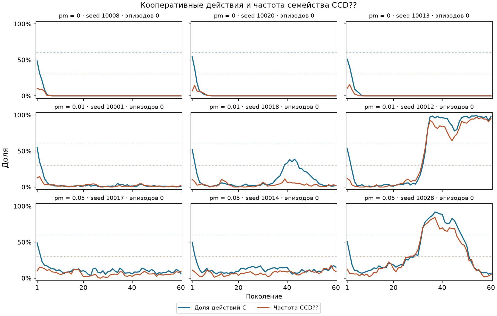
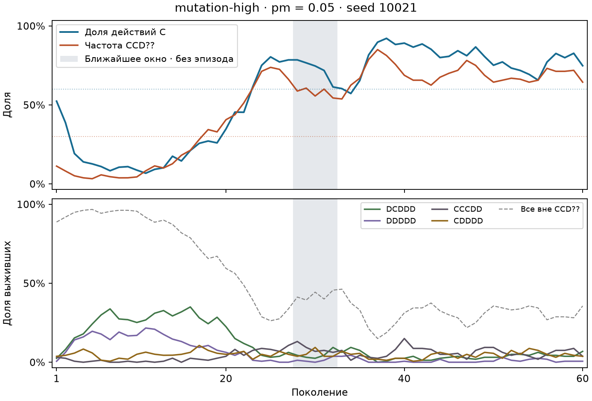
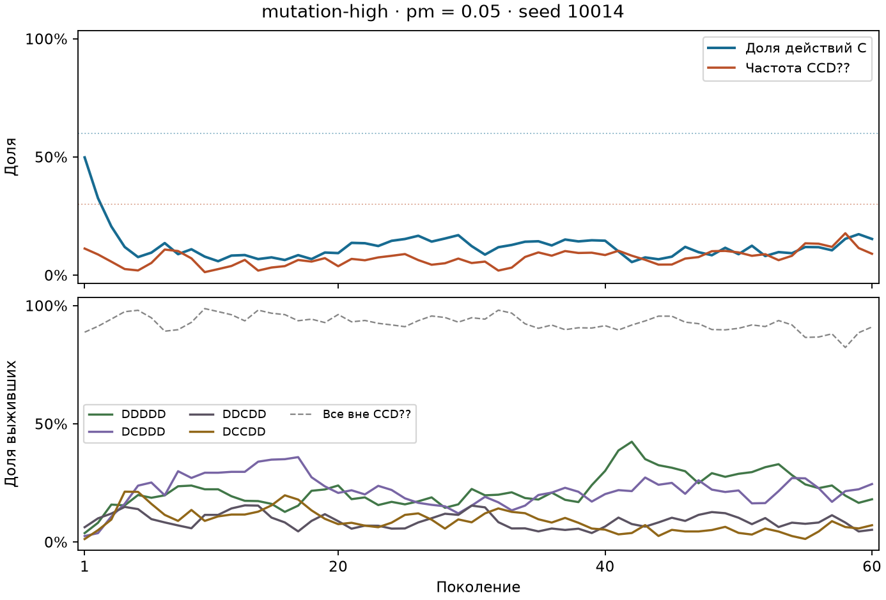
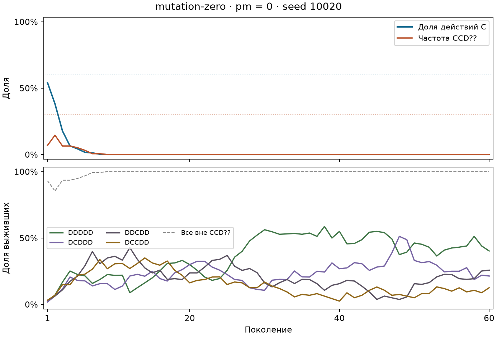

# Поведенческая кооперация и семейство CCD?? при мутации

## 1. Определения

В данных **нет отдельного генотипа `CCD`**. Генотип `Genotype` — пятисимвольная комбинация пяти бинарных локусов в порядке `firstMove`, `afterCC`, `afterCD`, `afterDC`, `afterDD`. В обозначениях исхода первой стоит предыдущая игра самого агента, второй — игра партнёра. Запись `CCD??` из пункта 1 фиксирует три локуса и допускает любые значения двух оставшихся. Ей соответствуют четыре точных ключа **`CCDCC`, `CCDCD`, `CCDDC`, `CCDDD`**. Все четыре начинают с C, отвечают C после CC и D после CD. `CCDCD` — отдельный генотип TFT. [Запись генотипа](../simulation/src/main/java/evolution/game/Genotype.java) · [Ключи экспорта](../simulation/src/main/java/evolution/simulation/MetricsCalculator.java) · [Протокол](../docs/research-protocol.md)

- **Cₜ** — доля действий C среди всех сыгранных действий поколения `t`.
- **f_CCDₜ** — суммарная частота четырёх точных генотипов семейства `CCD??` среди выживших на снимке поколения `t`. Эта трактовка сохраняет определение пункта 1. Чувствительность к выбору одного точного ключа показана отдельно.
- **Dₜ = Cₜ − f_CCDₜ**. У величин разные знаменатели, поэтому Dₜ нельзя интерпретировать как долю действий C, выполненных агентами вне семейства.
- **Эпизод расхождения** — максимальный непрерывный интервал из пяти или более поколений, на каждом из которых Cₜ ≥ 0,60 и f_CCDₜ ≤ 0,30. Несмежные отрезки считаются отдельно. При отсутствии эпизода его максимальная длительность записана как 0.

CSV охватывает все 1 880 сохранённых запусков. Поколения внутри запуска имеют одинаковый вес при расчёте средних, а запуски имеют одинаковый вес внутри группы. Для статистической проверки использованы только 120 запусков основной серии с общими seed 10001–10040, K=5, локальным спариванием, q=0,05 и α=0,20. Между этими сценариями меняется только pm.

## 2. Сводка по pm

| pm | Сценарий | n | Средняя C | Средняя f_CCD | Среднее D | С эпизодом |
|---:|---|---:|---:|---:|---:|---:|
| 0 (низкий) | `mutation-zero` | 40 | 0,0650 | 0,0502 | 0,0149 | 0/40 (0%) |
| 0,01 (средний) | `baseline` | 40 | 0,2683 | 0,2339 | 0,0344 | 0/40 (0%) |
| 0,05 (высокий) | `mutation-high` | 40 | 0,2389 | 0,1846 | 0,0543 | 0/40 (0%) |

Относительно pm=0,01 при pm=0,05 средняя f_CCD ниже на 4,93 п.п., средняя C ниже на 2,95 п.п., а разрыв D больше на 1,99 п.п. В сопоставимых сценариях пороги Cₜ и f_CCDₜ ни разу не выполняются одновременно даже в отдельном поколении.

Описательная сводка по всем сериям сохранена отдельно в том же CSV с меткой `all_descriptive`. При pm=0,01 эпизоды встречаются в 18 из 1 800 запусков (1,0%). Из них 17 относятся к `main/game-zero` с нулевым весом игровых выплат, один — к `sparse/global-matched`. Объединение этих сценариев смешивает эффект pm с различиями условий. [Сводка по pm](decoupling_by_pm.csv)

## 3. Рисунки

В каждой строке показаны запуски на 10-й, 20-й и 30-й позициях после сортировки 40 запусков по средней C. Пунктир показывает пороги Cₜ=0,60 и f_CCDₜ=0,30.

## 4. Проверка гипотезы

| pm | Pearson r | p | Spearman ρ | p |
|---:|---:|---:|---:|---:|
| 0 | 0,9979 | 0,00155 | 0,9997 | 0,00155 |
| 0,01 | 0,9895 | 0,00005 | 0,9337 | 0,00005 |
| 0,05 | 0,9879 | 0,00005 | 0,8476 | 0,00005 |

p получены перестановками внутри уровня и относятся к нулевой связи, а не к равенству корреляций. При вычитании корреляции низкого pm из корреляции высокого Δr=−0,0100 и Δρ=−0,1521. Связь ослабевает по ранговой мере и остаётся сильной. При pm=0 38 из 40 точек имеют C_final=f_CCD_final=0, поэтому сравнение чувствительно к двум оставшимся запускам.

В регрессии с категориальным pm и кластеризацией по seed коэффициент взаимодействия `f_CCD_final × pm=0,05` относительно pm=0 равен **+0,0115** (p=0,8487). Относительно pm=0,01 изменение наклона равно **−0,0387** (p=0,2243). Сдвиг при f_CCD_final=0 составляет +0,0277 относительно pm=0 (p=0,001885). Он соответствует небольшой прибавке к ожидаемой C вблизи нулевой частоты.

Для доли запусков с эпизодом во всех трёх группах наблюдается 0/40. Парный χ²-тест Кохрана Q не определён, поскольку нет вариации. Формальные попарные p Фишера равны 1 для вырожденных таблиц. Односторонняя точная 95% верхняя граница частоты для каждого условия равна 7,22%. [Полные коэффициенты, p и метод проверки](hypothesis_tests.md)

### Чувствительность к точному генотипу

В таблице число запусков с эпизодом при замене суммарной f_CCD на частоту одного точного генотипа. Пороги и длительность сохранены.

| Генетическая частота | pm=0 | pm=0,01 | pm=0,05 |
|---|---:|---:|---:|
| Семейство `CCD??` | 0/40 | 0/40 | 0/40 |
| `CCDCC` | 2/40 | 19/40 | 15/40 |
| `CCDCD` | 2/40 | 14/40 | 15/40 |
| `CCDDC` | 2/40 | 19/40 | 15/40 |
| `CCDDD` | 0/40 | 6/40 | 6/40 |

Высокая C совместима с редкостью любого отдельно взятого варианта. Это наблюдается и при среднем pm, когда остальные варианты того же семейства могут быть многочисленными.

## 5. Кейсы

**Высокий pm, ближайшее окно.** Эпизода по заданным порогам нет. В качестве замены выбран seed **10021**. Среди всех пятигенерационных окон высокого pm, в которых C всегда ≥ 0,60, у поколений 28–32 этого запуска минимальный максимум f_CCD. В этом окне C лежит в диапазоне 0,613–0,785, а f_CCD — 0,544–0,606. Самый частый отдельный генотип в окне — `CCDDD` из семейства, в среднем 30,1%. Среди генотипов вне семейства чаще всего встречается `CCCDD` (8,6%).

**Высокий pm без эпизода, seed 10014.** Типичный запуск по средним C и f_CCD среди оставшихся запусков при pm=0,05. В поколении 60 C=0,153, f_CCD=0,090.

**Низкий pm, seed 10020.** Запуск, ближайший к медианам средних C и f_CCD при pm=0. К поколению 10 обе величины достигают нуля и остаются на нуле до конца.

## 6. Механизм восстановления

**Регенерация семейства.** Из плато, определённых в пункте 1, f_CCD возвращается после нулевого снимка в 11/15 запусков основного baseline и в 9/15 запусков `reference/baseline`. В каждой серии в 7/15 плато возвращается даже первый C после полного отсутствия у выживших. Это согласуется с появлением заново первого C при ненулевом pm. При pm=0 первый C ни разу не вернулся после нулевого снимка, однако всё семейство `CCD??` возвращалось в пяти запусках до окончательного коллапса. Во всех пяти случаях непосредственно перед возвратом необходимые аллели C, C и D ещё присутствовали по отдельности в соответствующих локусах. Эта картина совместима с рекомбинацией. Родительские пары и события мутации в анализируемых рядах не записаны. [Анализ плато в пункте 1](REGIME_REPORT.md)

**Другие генотипы.** У `CCCDD` из кейса 10021 первый ход C и ответ после CC тоже C, поэтому он способен кооперировать. При этом `CCD??` в том же окне остаётся большинством. Частоты выживших и общие счётчики действий не позволяют распределить сыгранные C между генотипами. Анализ отдельных точных ключей показывает, что редкость TFT совместима с высокой C, пока другие варианты семейства сохраняются.

**Стартовая конфигурация.** Для каждого из 40 сопоставленных seed во всех трёх сценариях совпадают C₁ и частоты всех 32 генотипов в первом сохранённом снимке. Начальные различия между уровнями pm по этим измерениям не объясняют расхождение последующих траекторий. Снимка до первого поколения нет, поэтому роль исходного размещения и других различий между seed отдельно оценить нельзя.

## 7. Итог по гипотезе

**Не подтверждается.** При pm=0,05 средний разрыв D увеличивается, однако высокой C при низкой частоте всего семейства `CCD??` по заданным порогам не наблюдается. Ослабление ранговой корреляции не сопровождается обнаружимым изменением регрессионного наклона.

## 8. Проверяемые утверждения для курсовой

1. В трёх сценариях основной серии, различающихся только pm, ни один из 120 запусков не содержит пяти поколений подряд с C ≥ 0,60 и f_CCD ≤ 0,30.
2. При повышении pm с 0,01 до 0,05 средняя по запускам f_CCD падает с 0,234 до 0,185, а средняя C — с 0,268 до 0,239.
3. При pm=0,01 семейство `CCD??` возвращается после нулевого снимка в 20 из 30 плато двух сопоставимых серий K=5. При pm=0 наблюдались пять возвратов семейства, каждый в запуске, завершившемся коллапсом.

## 9. Артефакты и ограничения

- [Метрики 1 880 запусков](behavior_vs_genotype_metrics.csv), [сводка по pm](decoupling_by_pm.csv), [статистические проверки](hypothesis_tests.md).
- [Набор траекторий](../figures/decoupling_small_multiples.png) и три рисунка кейсов из раздела 5.
- Для соединения таблиц использованы профиль, сценарий, seed, номер повтора и поколение. Входные ряды содержат 124 800 поколений, по 32 записи генотипов в каждом. Суммы частот проверены; при сравнении порогов и определении совпадающих рангов f_CCD округлялась до 12 знаков для устранения погрешности сложения.
- Проверки разведочные, с номинальными p. Корреляция и регрессия используют снимки финального поколения и оценивают связь исходов. Эпизоды измеряют совместное выполнение порогов в течение наблюдаемого горизонта.
