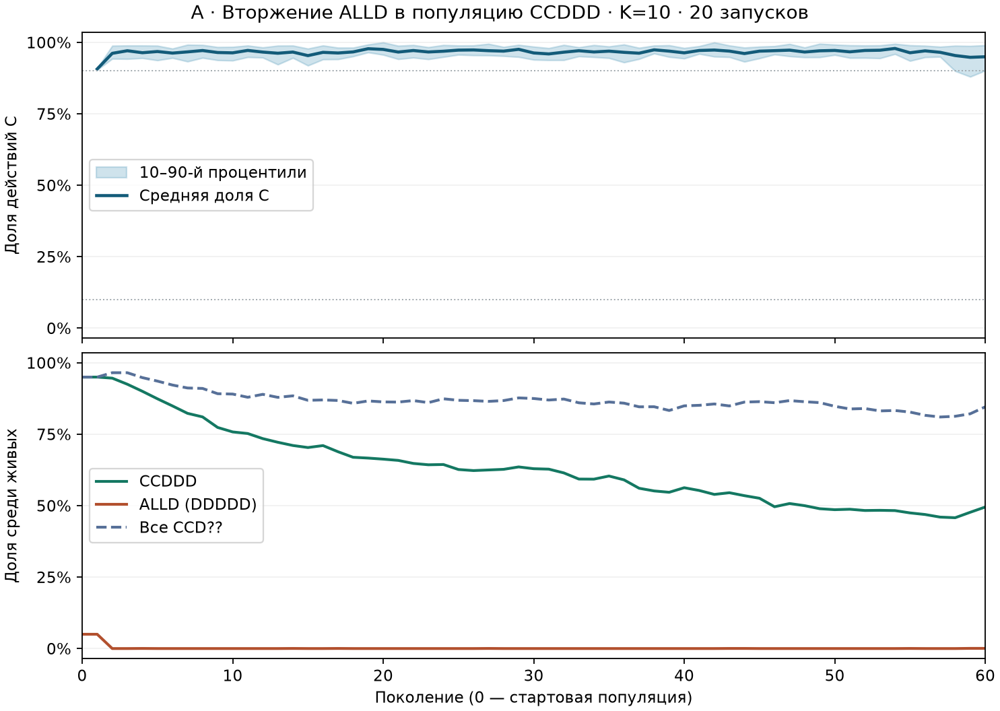
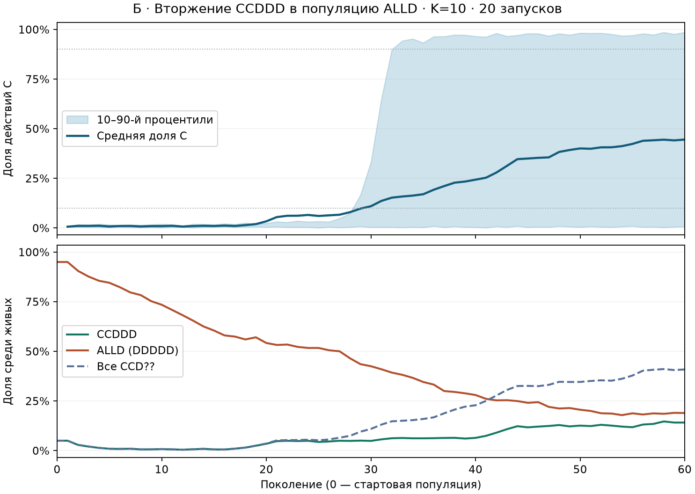

# Устойчивость кооперативного плато к вторжению

## 1. Параметры эксперимента

Использован сценарий `rounds-10` основной серии. В пункте 1 он дал 27 плато из 40, а `CCDDD` был самым частым точным генотипом в конце этих 27 плато (в среднем 43,3% среди живых). `CCDDD` начинает встречу с C, сохраняет C после CC и отвечает D после остальных исходов. Дефектор ALLD (`DDDDD`) всегда играет D. [Типология плато](REGIME_REPORT.md) · [Кодировка генотипа](../simulation/src/main/java/evolution/game/Genotype.java)

| Условие | Стартовые CCDDD | Стартовые ALLD | Повторы |
|---|---:|---:|---:|
| А · Вторжение дефекторов | 152 (95%) | 8 (5%) | 20 |
| Б · Вторжение кооператоров | 8 (5%) | 152 (95%) | 20 |

Параметры из исследовательского профиля и сценария `rounds-10` приведены ниже. В обеих сериях они одинаковы. [Профиль](../profiles/research.properties) · [Сценарии](../simulation/src/main/java/evolution/experiment/StudyScenarios.java)

| Параметр | Значение |
|---|---|
| Решётка и начальная популяция | 20×20, 160 агентов |
| Горизонт | 60 поколений по 50 тактов |
| Встречи | Локальные, K=10 раундов |
| Энергия | 10 на старте, ресурс даёт 4, жизнь стоит 1 за такт |
| Вероятность появления ресурса и вес выплат | q=0,05, α=0,20 |
| Размножение | Турнир из трёх, p_c=0,80, p_m=0,01 |

Для каждой пары запусков использован одинаковый seed (41001–41020), одинаковое начальное размещение агентов и ресурсов и одни и те же восемь случайно выбранных позиций для меньшинства. Вспомогательный Java-запускатель получает доступ к сетке до первого такта и заменяет только генотипы, сохраняя ID, позиции, энергию и состояние генератора модели. Дальше работает штатный `SimulationSession`. Все 40 запусков завершились без вымирания; выполнение с компиляцией и построением рисунков заняло 34 секунды на OpenJDK 25.0.4.1. [Запускатель](../tools/InvasionStudy.java) · [Скрипт воспроизведения](../tools/run_invasion.py)

## 2. Рисунки

Верхние панели показывают среднюю долю действий C и полосу между 10-м и 90-м процентилями по запускам. Нижние панели показывают средние доли двух исходных генотипов и всего семейства `CCD??` среди живых. Поколение 0 — стартовый снимок до игр.

## 3. Результаты

| Показатель | А · Вторжение ALLD | Б · Вторжение CCDDD |
|---|---:|---:|
| Средняя C в поколении 1 | 0,907 | 0,007 |
| Средняя C в поколении 60 | 0,950 | 0,446 |
| Медиана C в поколении 60 | 0,969 | 0,026 |
| C > 0,90 в поколении 60 | 18/20 | 9/20 |
| C > 0,90 во всех поколениях 51–60 | 17/20 | 6/20 |
| C < 0,10 в поколении 60 | 0/20 | 11/20 |
| `CCD??` составляет большинство в поколении 60 | 20/20 | 9/20 |

**А · ALLD не захватывает кооперативную популяцию.** В поколении 1 все восемь исходных ALLD ещё живы. К концу поколения 2 точный генотип ALLD исчезает во всех 20 запусках и ни разу впоследствии не превышает стартовые 5%. К поколению 60 он отсутствует в 18 запусках, в двух присутствует по одной особи. У двух запусков, которые закончили ниже порога плато, конечная C равна 0,835 и 0,680. При этом семейство `CCD??` сохраняет большинство во всех 20 запусках, хотя сам исходный `CCDDD` остаётся большинством только в 11.

**Б · Высокая кооперация возникает в части исходно дефекторских миров.** Девять запусков впервые пересекают C > 0,90 между поколениями 22 и 57 и заканчивают выше этого порога. В оставшихся 11 конечная C ниже 0,10. Точный `CCDDD` составляет большинство в конце только в 2/20 запусках, а у 8 из 9 запусков с высокой конечной C он хотя бы раз отсутствовал среди живых. В пяти из этих девяти запусков исчезал даже первый аллель C, а затем появлялся вновь. Следовательно, достижение высокой C в этом условии включает восстановление кооперативных генотипов при действующей мутации. По этим рядам нельзя проследить родословные или отделить вклад восьми основателей от появления новых вариантов. [Погенерационные данные](invasion_results.csv)

## 4. Вывод

**При K=10 кооперативное плато устойчиво к проверенному вторжению 5% ALLD на горизонте 60 поколений.** ALLD теряет исходную долю, а высокая кооперация сохраняется в большинстве запусков. При обратном старте возможны оба исхода. Это устойчивость поведения к одному конкретному возмущению в пространственной популяции с мутацией и рекомбинацией. Статус ESS для точного генотипа `CCDDD` или для состава плато этим опытом не установлен. Проверен один инвадер и одна стартовая частота, а состав кооперативного большинства меняется по ходу эксперимента. Отдельного контроля со 100% ALLD нет, поэтому 9/20 характеризует вероятность высокой C при заданном старте, а не эффект добавления кооператоров относительно чистой популяции ALLD.

## 5. Проверяемые утверждения для курсовой

1. При K=10 после добавления 5% ALLD к `CCDDD` точный ALLD отсутствует к концу поколения 2 во всех 20 запусках. В 17 из 20 запусков C > 0,90 во всех последних десяти поколениях.
2. При стартовых 95% ALLD и 5% `CCDDD` в поколении 60 получены девять запусков с C > 0,90 и одиннадцать с C < 0,10. В пяти из девяти запусков с высокой C первый аллель C ранее исчезал из популяции выживших.

## Данные и воспроизведение

Из корня ветки выполните `python tools/run_invasion.py` с JDK 25, NumPy и Matplotlib. Скрипт компилирует запускатель во временный каталог, запускает модель, проверяет стартовые пропорции, последовательность поколений и согласованность счётчиков и сохраняет CSV и оба рисунка. В CSV есть 2 440 строк данных, включая 40 стартовых снимков. Столбцы `n_*` содержат абсолютные численности всех 32 генотипов. Доля генотипа равна его численности, делённой на `living_agents`. Для поколения 0 доля действий C пуста.
