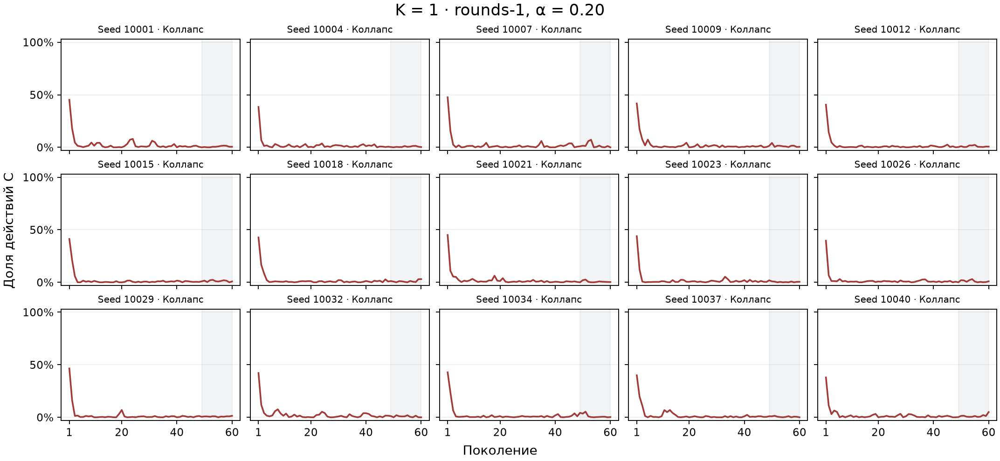
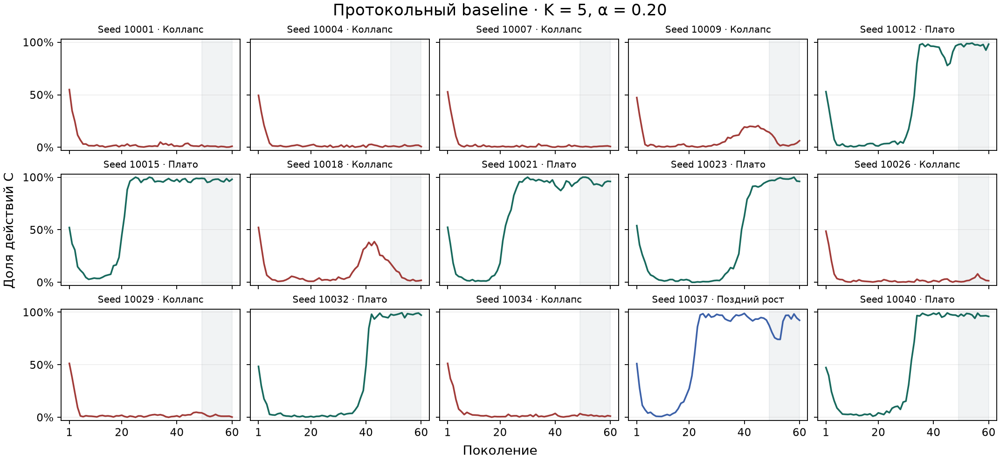
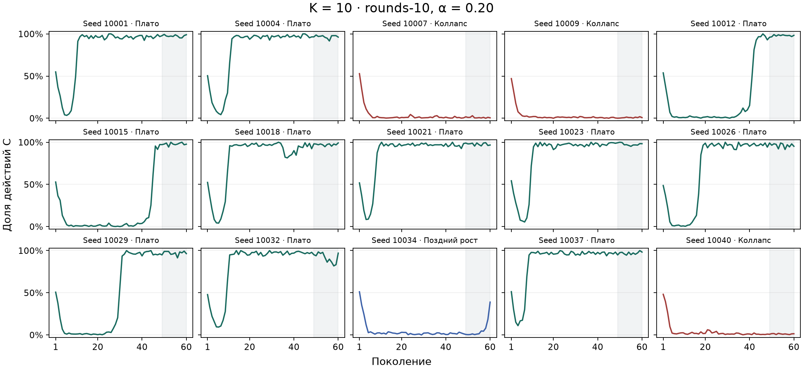
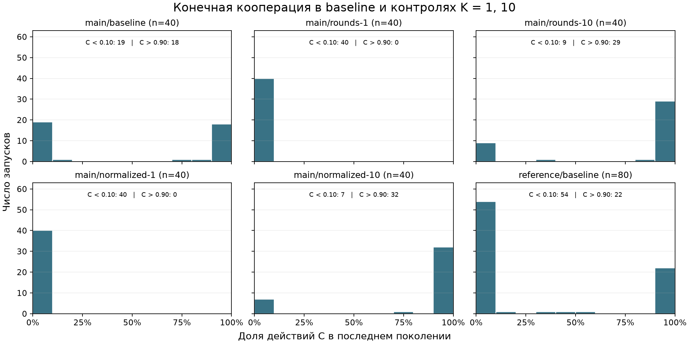
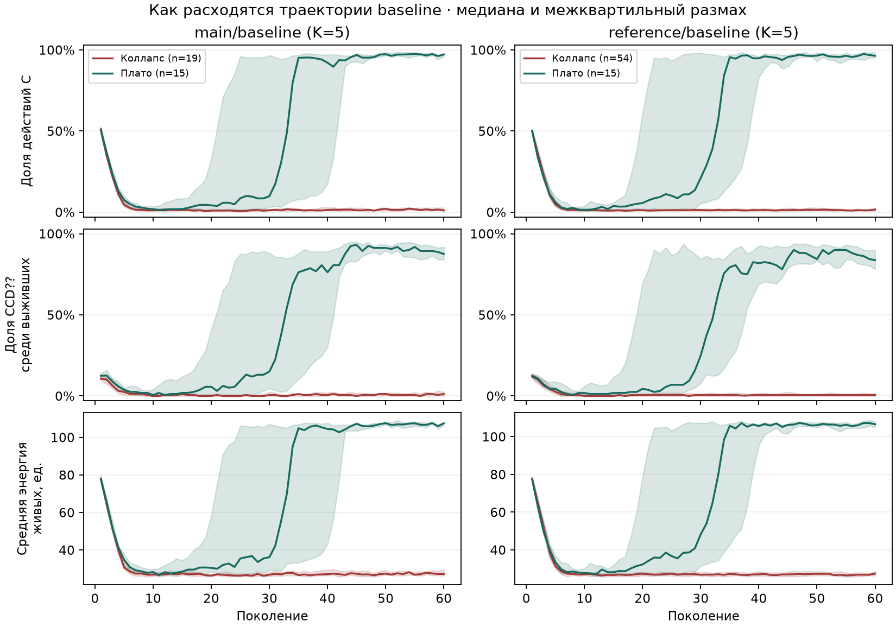
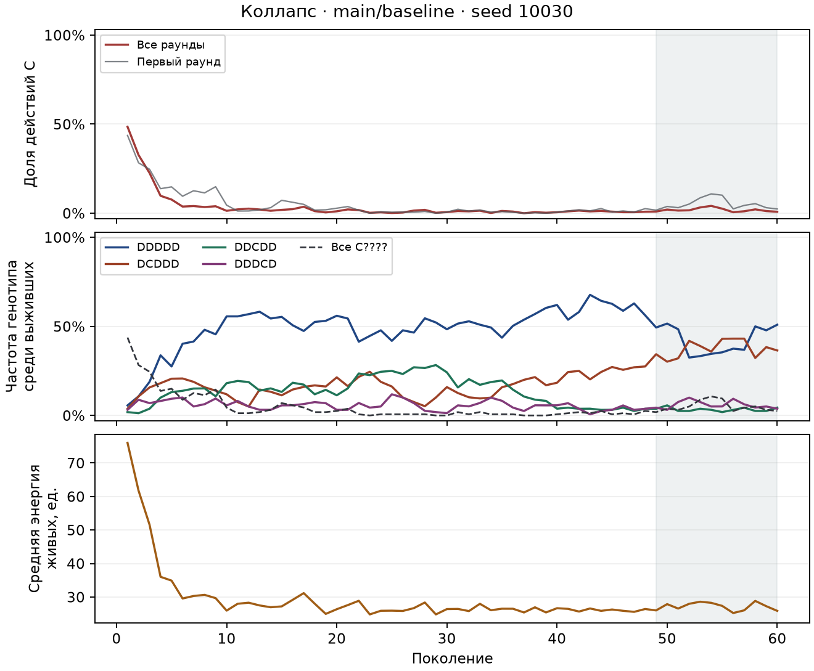
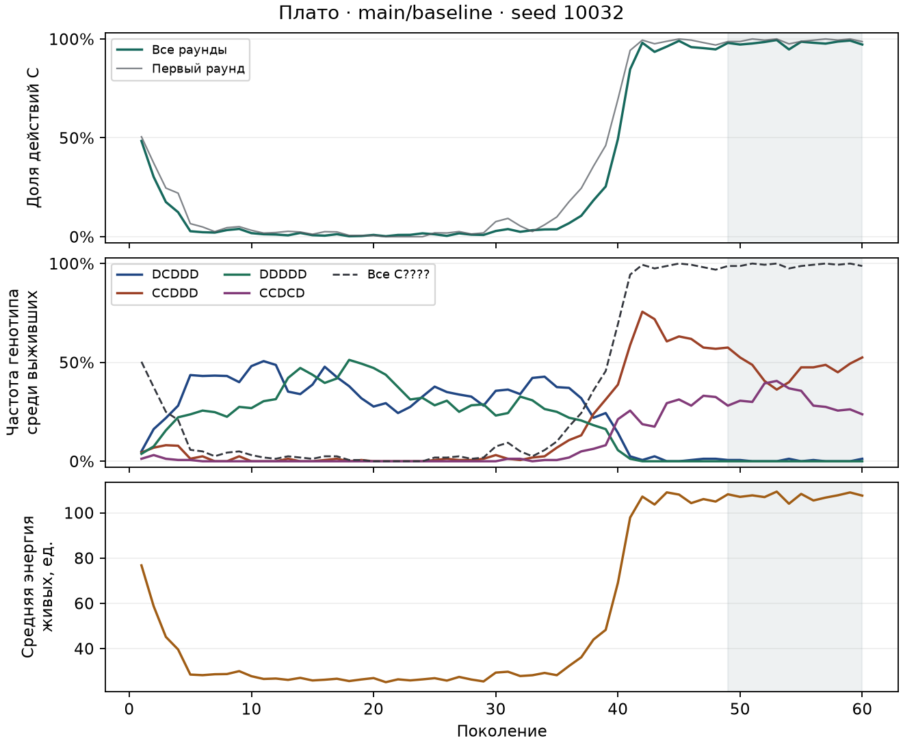
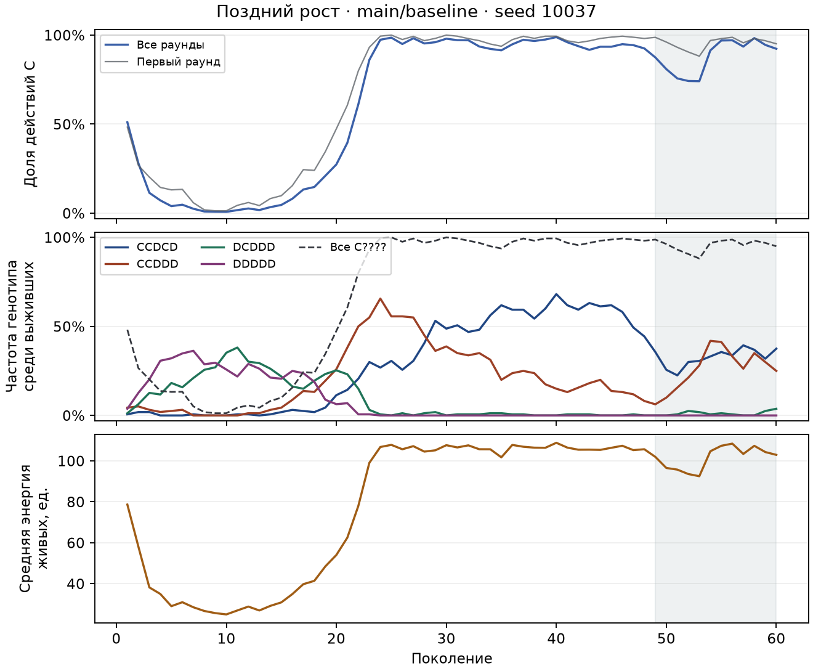
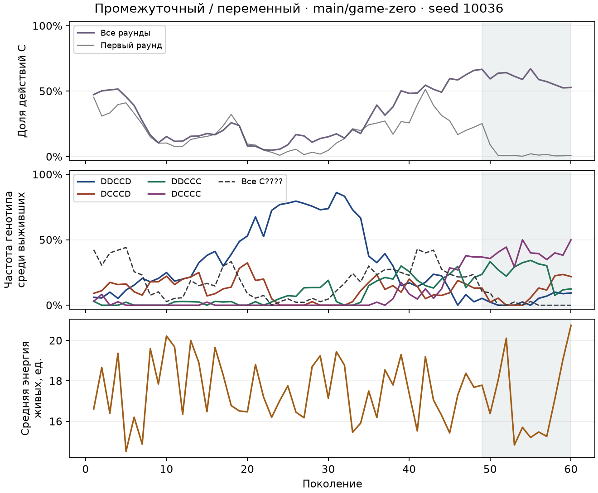

# Типология траекторий кооперации

## 1. Дерево репозитория

Крупные ветви дерева `main` и локальные входные каталоги, найденные после `git ls-files`.

```text
README.md
docs/
├── research-protocol.md
├── protocol-addendum.md
└── robustness-protocol.md
profiles/
research/                                  материалы и сводки
simulation/                                модель и запуск серий
tools/
results/                                   локальные первичные данные вне Git
├── main-20261020/
└── robustness-20261102/
    ├── reference-data/
    ├── small-data/   large-data/
    ├── sparse-data/  dense-data/
    └── long-data/
```

README указал, где искать исходные данные. Затем протоколы и дополнение задали сценарии, горизонты, диапазоны seed и правила обработки вымирания. После инвентаризации проверил заголовки и первые записи первичных CSV и загрузил нужные поля. [README](../README.md) · [Основной протокол](../docs/research-protocol.md) · [Дополнение](../docs/protocol-addendum.md) · [Протокол дополнительной серии](../docs/robustness-protocol.md)

## 2. Что было в данных

Основная серия содержит 480 запусков, дополнительная — 1400 запусков в шести профилях. Все 1880 завершились без вымирания и содержат полный ряд из 60 поколений (120 в `long`), всего 124 800 поколений. В `generations.csv` сохранены доля C среди сыгранных действий, доля C в первых раундах и средняя энергия живых; `runs.csv` хранит параметры, а `genotype-frequencies.csv` — частоты 32 генотипов среди выживших в каждом поколении.

Протокольный `baseline` имеет **K=5**. Условия с K=1 называются `rounds-1` (вес выплат α=0,20) и `normalized-1` (α=1,00). Ниже они показаны отдельно. Сценарии с K=10 тоже разделены по α.

## 3. Режимы и пороги

Последнее окно включает 20% поколений с округлением вверх, то есть поколения 49–60 либо 97–120. `slope_last20` — наклон линейной регрессии C на номер поколения в этом окне, в долях C за поколение. `range_C` в CSV — размах **всего** ряда; для классификации используется размах **окна** ΔC₂₀. Правила применяются сверху вниз.

1. **Коллапс** (`collapse`) при конечной C < 0,10 и ΔC₂₀ ≤ 0,20.
2. **Плато** (`plateau`) при конечной C > 0,90 и ΔC₂₀ ≤ 0,20.
3. **Поздний рост** (`slow_growth`), если наклон × (число поколений окна − 1) ≥ 0,10. В эту группу попадают и восстановления после провала внутри окна.
4. **Промежуточный или переменный режим** (`variable`) во всех остальных случаях. Сюда входят колебания, промежуточные уровни и поздние спады.

Границы 0,10 и 0,90 выделяют крайние конечные значения, допуск 0,20 отсекает крупные недавние переходы, а прирост по тренду на 0,10 выделяет заметное позднее повышение. При замене допуска 0,20 на 0,15 или 0,25 в основном baseline остаётся 18–19 коллапсов и 15–16 плато из 40. В дополнительном `reference` остаётся 54 коллапса и 12–16 плато из 80.

## 4. Рисунки

Для каждого набора малых графиков взяты 15 равномерно расположенных позиций в списке запусков по seed. Серым выделены последние 20% поколений.







### Распределение конечной C



У основного `baseline` **19/40** запусков имеют конечную C < 0,10, **18/40** — C > 0,90. Ни одного финала между 0,20 и 0,70. В `reference/baseline` хвосты включают **54/80** и **22/80** запусков соответственно. Это визуальная бимодальность конечного распределения. Пакета для dip-теста Хартигана в доступном Python-окружении не было, поэтому p-value не рассчитано. Для K=1 в основной серии оба варианта веса дают 40/40 финалов ниже 0,10. Во всех пяти дополнительных профилях с `normalized-1` этот исход повторяется для каждого запуска (200/200).

### От раннего спада к двум исходам



- **Общий ранний спад.** В обеих сериях каждый будущий коллапс и каждое будущее плато хотя бы раз опускаются ниже C=0,10 к поколению 20. В основном baseline медиана C(10) равна 0,011 для будущих коллапсов и 0,019 для будущих плато. К поколению 40 медианы расходятся до 0,014 и 0,921.
- **Расширение условно кооперирующих генотипов.** Во всех 15 плато основной серии и всех 15 плато `reference` доля `CCD??` среди выживших превышает 0,50 за поколение до первого отрезка из трёх поколений с C > 0,90 после спада. Этот отрезок в обеих сериях начинается в медиане на поколении 35. В основном baseline конечная медианная доля `CCD??` равна 0,875 на плато и 0,012 при коллапсе; средняя энергия живых в медианном запуске по этому показателю равна 107,48 и 27,22 единицы соответственно в поколении 60.
- **Потеря и возврат первого C.** Среди основных плато в 7 из 15 запусков доля `C????` среди выживших хотя бы раз была нулевой, а затем восстановилась. При pm=0 все 38 коллапсов теряют первый C и заканчиваются с C=0; оба плато сохраняют этот аллель. Вместе эти наблюдения согласуются с ранним вытеснением первого C и возможным восстановлением кооперации после распространения `CCD??`. Частоты по поколениям позволяют установить последовательность событий, а происхождение восстановившихся генотипов и вклад отдельных механизмов в рост энергии по этим данным не идентифицируются.

### По одному случаю на режим

Для первых трёх режимов выбран запуск протокольного baseline, для переменного режима — запуск основной серии. В каждой группе выбран ближайший к покомпонентным медианам конечной C, прироста по тренду и размаха окна. На рисунках показаны четыре наиболее частых за весь запуск генотипа, суммарная доля `C????` и средняя энергия живых.

**Коллапс, seed 10030.** После спада C(10)=0,013, C(60)=0,008; средняя энергия в конце 25,86.



**Плато, seed 10032.** В поколении 20 C=0,009 и первый C среди выживших отсутствует. К поколению 60 C=0,972, частота первого C достигает 0,988, энергия — 107,59.



**Поздний рост, seed 10037.** C уже достигает 0,925 к поколению 48. Затем следует провал и восстановление до 0,923, так что тренд внутри последнего окна положителен.



**Переменный режим, `game-zero`, seed 10036.** C меняется от 0,082 в поколении 20 до 0,659 в поколении 48 и 0,528 в конце. Вес игровых выплат в этом условии равен нулю.



## 5. Условие × режим

Ячейки содержат число и долю запусков внутри условия. В основном baseline pm=0,01 и вероятность появления ресурса q=0,05. Для `mutation-zero` pm=0, для `mutation-high` pm=0,05. Для `resource-poor` q=0,02, для `resource-rich` q=0,25. Профили дополнительной серии показаны раздельно из-за различий размера, плотности или горизонта; все их сценарии приведены в [CSV](regime_by_condition.csv).

| Условие | K | n | Коллапс | Плато | Поздний рост | Переменный |
|---|---:|---:|---:|---:|---:|---:|
| main/baseline | 5 | 40 | 19 (47,5%) | 15 (37,5%) | 5 (12,5%) | 1 (2,5%) |
| main/game-zero | 5 | 40 | 2 (5%) | 0 (0%) | 9 (22,5%) | 29 (72,5%) |
| main/global | 5 | 40 | 24 (60%) | 13 (32,5%) | 2 (5%) | 1 (2,5%) |
| main/global-matched | 5 | 40 | 26 (65%) | 5 (12,5%) | 3 (7,5%) | 6 (15%) |
| main/mutation-high | 5 | 40 | 9 (22,5%) | 0 (0%) | 5 (12,5%) | 26 (65%) |
| main/mutation-zero | 5 | 40 | 38 (95%) | 2 (5%) | 0 (0%) | 0 (0%) |
| main/normalized-1 | 1 | 40 | 40 (100%) | 0 (0%) | 0 (0%) | 0 (0%) |
| main/normalized-10 | 10 | 40 | 7 (17,5%) | 27 (67,5%) | 5 (12,5%) | 1 (2,5%) |
| main/resource-poor | 5 | 40 | 21 (52,5%) | 14 (35%) | 4 (10%) | 1 (2,5%) |
| main/resource-rich | 5 | 40 | 23 (57,5%) | 10 (25%) | 3 (7,5%) | 4 (10%) |
| main/rounds-1 | 1 | 40 | 40 (100%) | 0 (0%) | 0 (0%) | 0 (0%) |
| main/rounds-10 | 10 | 40 | 9 (22,5%) | 27 (67,5%) | 3 (7,5%) | 1 (2,5%) |
| reference/baseline | 5 | 80 | 54 (67,5%) | 15 (18,75%) | 11 (13,75%) | 0 (0%) |
| reference/global | 5 | 80 | 52 (65%) | 17 (21,25%) | 9 (11,25%) | 2 (2,5%) |
| reference/global-matched | 5 | 80 | 48 (60%) | 20 (25%) | 9 (11,25%) | 3 (3,75%) |
| reference/resource-poor | 5 | 80 | 41 (51,25%) | 22 (27,5%) | 8 (10%) | 9 (11,25%) |
| reference/resource-rich | 5 | 80 | 51 (63,75%) | 14 (17,5%) | 10 (12,5%) | 5 (6,25%) |
| small/baseline | 5 | 40 | 27 (67,5%) | 4 (10%) | 5 (12,5%) | 4 (10%) |
| large/baseline | 5 | 40 | 28 (70%) | 5 (12,5%) | 6 (15%) | 1 (2,5%) |
| sparse/baseline | 5 | 40 | 23 (57,5%) | 8 (20%) | 6 (15%) | 3 (7,5%) |
| dense/baseline | 5 | 40 | 25 (62,5%) | 11 (27,5%) | 3 (7,5%) | 1 (2,5%) |
| long/baseline | 5 | 40 | 13 (32,5%) | 11 (27,5%) | 8 (20%) | 8 (20%) |

## 6. Предикторы режима

Логистическая регрессия на 371 коллапсе или плато основной серии лучше всего различает исходы по K. При учёте веса выплат и спаривания коэффициенты логарифма шансов плато для K=1 и K=10 относительно K=5 равны −2,30 и +1,67. Для pm=0 и pm=0,05 относительно pm=0,01 коэффициенты равны −1,57 и −1,15; ресурсные коэффициенты меньше по модулю. Эти оценки условны на попадание в один из двух режимов. Например, при pm=0,05 26/40 траекторий относятся к переменному режиму.

Отдельной переменной стартового состояния и поколения 0 нет. Доля C(1) служит прокси уже после начала взаимодействий. Её добавление к параметрам не повысило качество на отложенных seed. ROC AUC составила 0,814 для одних параметров и 0,808 с C(1). С дополнительными контролями веса выплат и спаривания AUC равна 0,824. [Коэффициенты, схема проверки и Brier](regime_predictors.md)

## 7. Что это меняет в выводах курсовой

Бимодальность относится к протокольному K=5 и воспроизводится в `reference`; при K=1 оба условия основной серии дают 40 коллапсов из 40. При неизменном весе выплат α=0,20 в серии K=10 встречаются и коллапс (9/40), и плато (27/40). Во всех 30 плато двух сопоставимых серий K=5 после раннего падения C ниже 0,10 первому отрезку из трёх поколений с C > 0,90 предшествует большинство `CCD??` среди выживших.

## 8. Артефакты и ограничения

- [Классификация 1880 запусков](regime_classification.csv), [числа и доли для 42 условий](regime_by_condition.csv), [логистическая регрессия](regime_predictors.md).
- В `figures/` сохранены три набора траекторий, гистограммы, сводная динамика baseline и четыре рисунка отдельных запусков. Пути указаны в разделе 4.
- [Скрипт воспроизведения](regime_analysis.py) требует NumPy и Matplotlib. Из корня ветки выполните `python analysis/regime_analysis.py /путь/к/results`. Три входных CSV каждого профиля сверены с сохранёнными SHA256.
- Режимы и проверки разведочные, за пределами семейства из 22 протокольных сравнений. Конечный горизонт ограничивает выводы об устойчивости. Например, в `long/baseline` 23/40 запусков имеют конечную C > 0,90, но только 11/40 классифицируются как плато в 24-поколенном окне.
- Доступны частоты генотипов и средняя энергия по поколению. Родословные, стартовые генотипы до отбора и энергия по отдельным генотипам в использованных таблицах отсутствуют.
