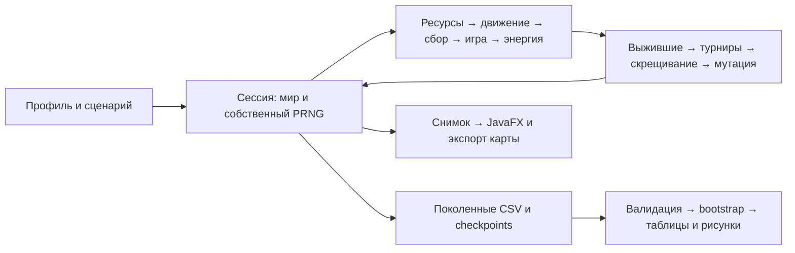
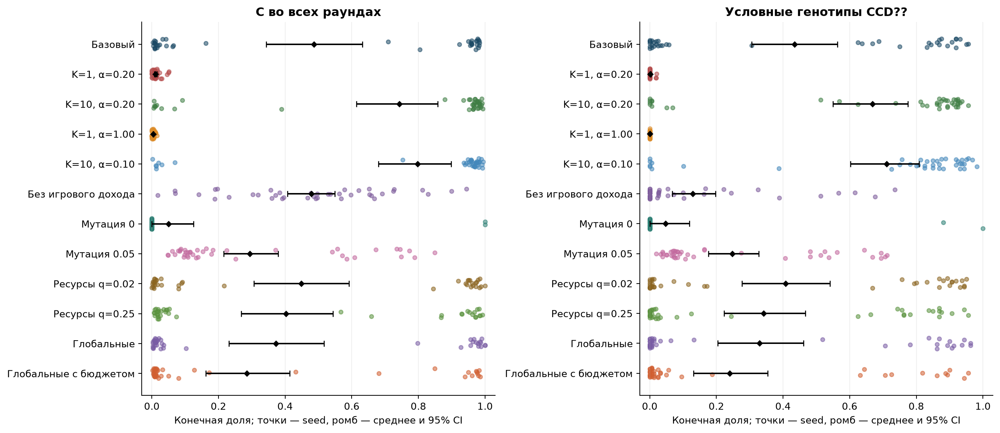
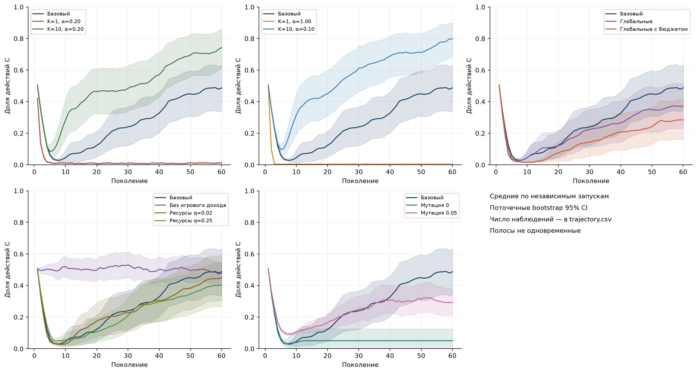
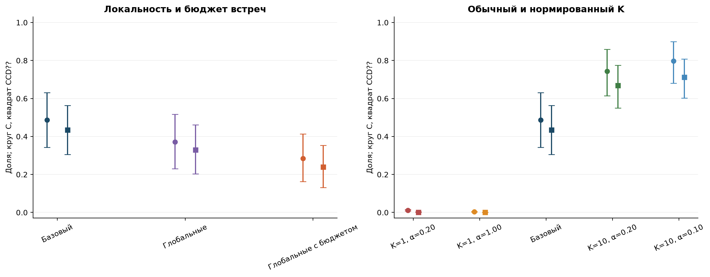
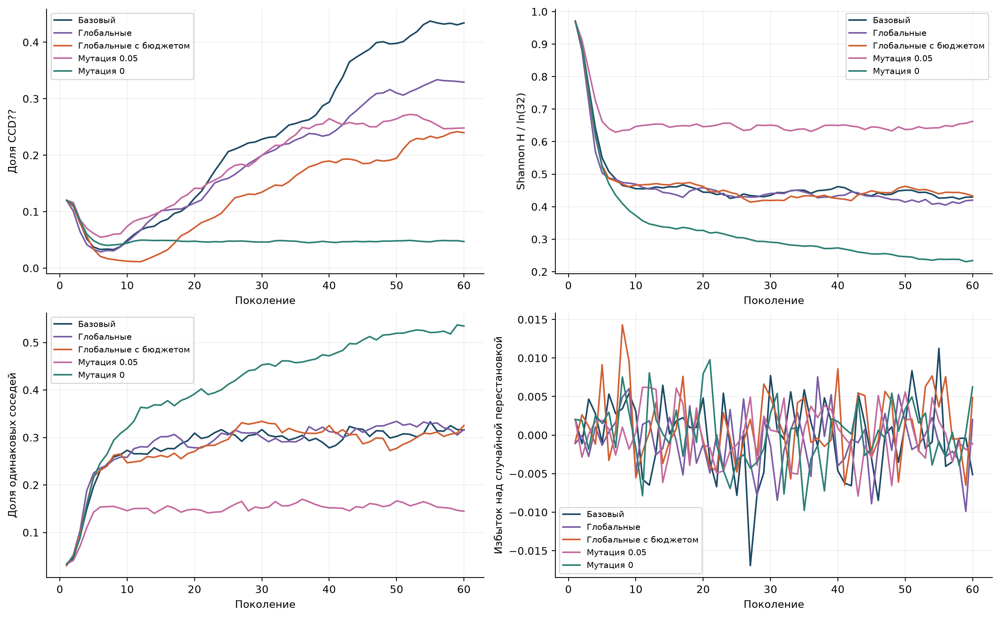
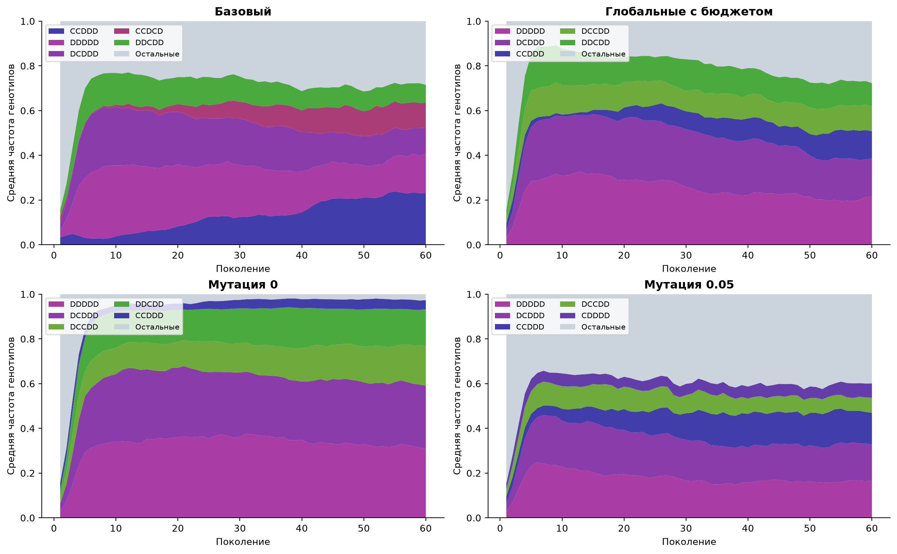
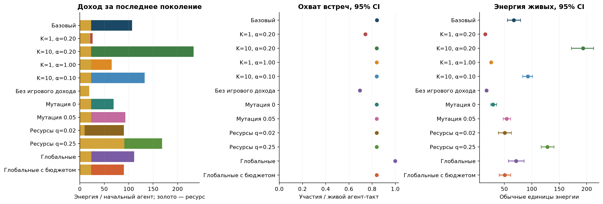
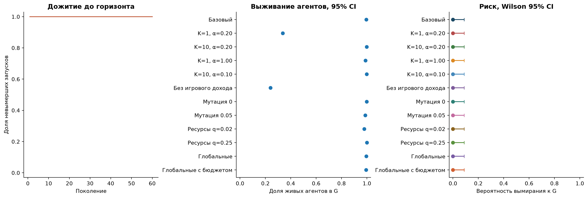
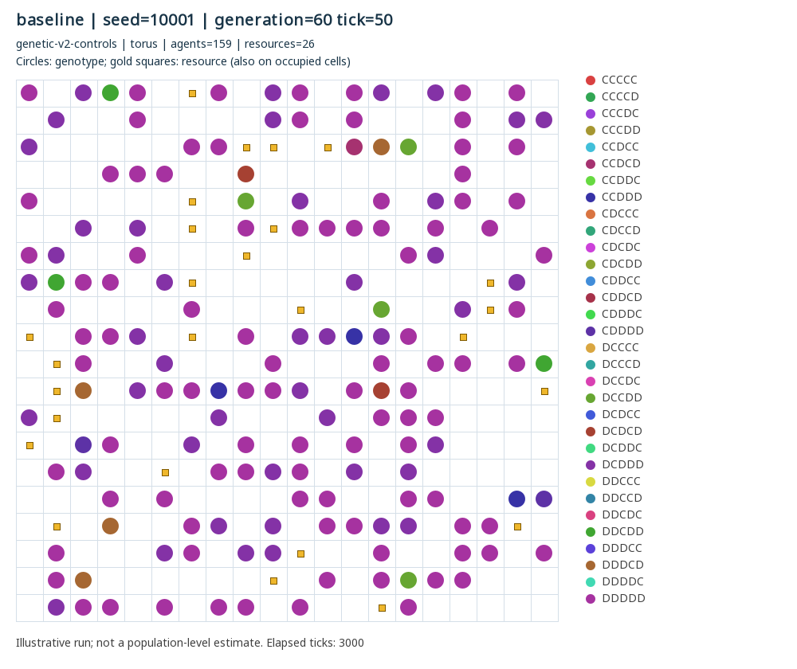
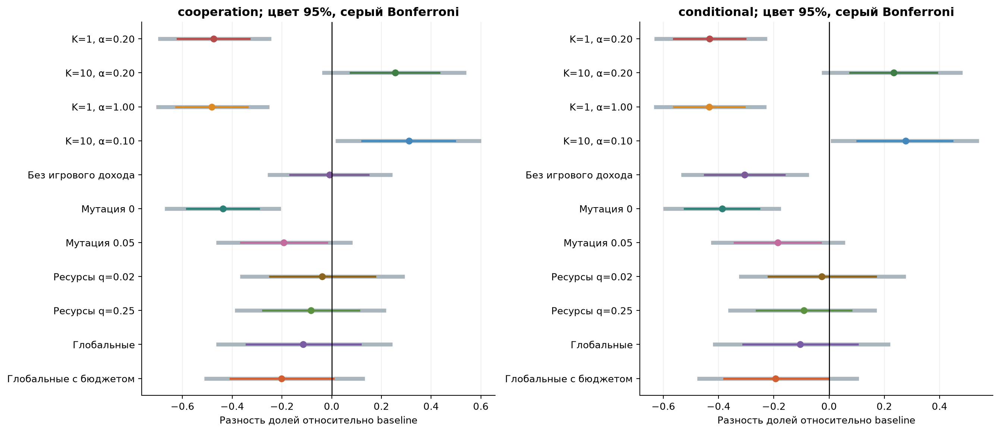

# Эволюция сотрудничества при генетическом отборе в ресурсной пространственной среде

Пояснительная записка к исследовательской работе по генетическим алгоритмам. Расчёт 20 октября 2026 года; модель `genetic-v2-controls`, схема данных 2.

[Локальный отчёт](../research/study-20261020/report.html) · [Протокол](research-protocol.md) · [Все численные оценки](../research/study-20261020/summary.csv) · [Материалы защиты](defense.md).

## Аннотация

Исследована искусственная популяция, в которой агенты случайно движутся по тору, собирают ресурсы и играют повторяющуюся дилемму заключённого. Пять бинарных генов кодируют первый ход и реакции на предыдущий раунд. Генетический алгоритм использует турнирный отбор по энергии выживших, одноточечное скрещивание и независимые мутации. Выполнено 480 запусков: 12 сценариев по 40 seed, по 60 поколений. Введены контроль частоты встреч при глобальном спаривании и контроль масштаба энергетических выплат при изменении числа раундов.

В нормированном ряду средняя конечная доля C составила 0.004 при одном раунде, 0.487 при пяти и 0.797 при десяти. Это конечные средние по неоднородным запускам: в baseline 19 из 40 имеют C<0.1, а 18 — C>0.9. Нулевая мутация дала C=0.050; разведочный анализ показал потерю аллеля первого сотрудничества в 38 запусках. Высокая C без игрового дохода не сопровождалась такой же долей условных генотипов или выживаемостью. Различия ресурсов и структуры встреч оценены недостаточно точно для сильных выводов о сотрудничестве. Результаты относятся к данной модели и конечному горизонту, а не к универсальному закону эволюции взаимности.

## 1. Постановка задачи

Исследовательский вопрос: **при каких условиях в модели возникают и сохраняются сотрудничество и условные стратегии и как это связано с повторяемостью, структурой встреч, ресурсами и мутацией?**

Работа решает две связанные задачи: проверяет реализацию эволюционной модели и проводит воспроизводимый вычислительный эксперимент. Социальное поведение измеряется отдельно от наследуемых реакций. Сотрудничество не вводится как цель оптимизации: отбор видит конечную энергию, а доля C — наблюдаемый результат.

Гипотезы, сравнения и статистические методы зафиксированы после небольшого пилота, до основной серии. H1 связывает повторяемость с сотрудничеством, H2 — структуру контактов с отличиями после контроля охвата игр, H3 предполагает снижение концентрации условных стратегий при повышении мутации, H4 касается энергетического и демографического действия ресурсов и игры без заранее заданного направления изменения C. Отрицательные и неточные результаты сохраняются.

## 2. Литературный контекст и место генетического алгоритма

Axelrod и Hamilton рассматривают взаимность в дилемме заключённого и условия её распространения [1]. Это мотивация исследования, а не гарантия успеха TFT в нашей среде. Здесь встречи имеют фиксированную длину, память сбрасывается перед новой встречей, а приспособленность включает ресурсы и смертность.

Nowak и May показывают пространственную организацию поведения в игре с локальными соседями [2]. Наша модель существенно отличается: агенты движутся, играют не более одной встречи за такт, а потомки каждого поколения расселяются случайно по всему миру. Поэтому механизмы устойчивых наследуемых пространственных кластеров нельзя переносить из этой работы автоматически.

Связь с генетическими алгоритмами непосредственная: конечная популяция хромосом, оценка приспособленности, турнирный выбор родителей, рекомбинация и мутация. Общий подход к адаптации посредством наследования и рекомбинации представлен Holland [3]. Здесь функция приспособленности не фиксирована для отдельного генотипа: она зависит от других стратегий, расположения и ресурсов. Это коэволюционная задача, а не поиск максимума заранее известной таблицы. Элитизма нет; лучший генотип может исчезнуть. Полный перебор 32 генотипов полезен для описания поведения, но не заменяет симуляцию частотно-зависимого отбора.

Bootstrap [4] применяется к независимым запускам. Интервал Wilson [5] используется для вероятности вымирания. Эти методы оценивают неопределённость, связанную с seed при фиксированных правилах; они не учитывают неопределённость выбора самой модели.

## 3. Формальная модель

### 3.1. Состояние и такт

Мир — тороидальная решётка L×L с окрестностью Мура. В клетке может быть один живой агент и один ресурс одновременно. Агент имеет уникальный в пределах запуска ID, координату, энергию E в целых сотых и неизменяемый генотип. Изначально N различных позиций выбираются без возвращения, все гены независимо равновероятны. Ресурсный слой инициализируется с вероятностью q на клетку.

Такт выполняет следующие фазы:

1. Независимое восстановление ресурса с вероятностью q в каждой клетке без ресурса, включая занятую агентом.
2. Выбор каждым агентом свободного на начало движения соседа или своей клетки; синхронное разрешение конфликтов случайным победителем. Переход на занятую в начале фазы клетку и обмен позициями запрещены.
3. Сбор ресурса под агентом, получение R и удаление ресурса.
4. Формирование непересекающихся пар и игра K раундов.
5. Одновременное обновление E←E+Rᵢ+αΠᵢ−c. При E≤0 агент удаляется; на месте смерти появляется ресурс, доступный только в следующих тактах.

В LOCAL список живых агентов перемешивается, каждый ещё свободный агент выбирает случайного свободного соседа. Это случайное жадное паросочетание, не максимальное по числу пар. GLOBAL перемешивает всех живых и соединяет соседние элементы списка; при нечётном числе один агент не играет. В GLOBAL_MATCHED сначала вычисляется число M локальных пар на данном состоянии, затем независимо перемешиваются все живые и образуются ровно M глобальных пар. Случайность каждого запуска целиком принадлежит своему PRNG `L64X128MixRandom`.

### 3.2. Игра и генотип

Генотип g=(g₀,gCC,gCD,gDC,gDD) содержит действия C или D. После первого хода последующие действия определяются собственным и чужим действием **предыдущего** раунда. Для второго игрока исход CD первого означает собственный DC. Действия раунда выбираются одновременно. Память фиксирована одним раундом, между встречами не сохраняется; K меняет число возможностей отреагировать, не длину памяти.

| Исход | Выплата первому | Выплата второму |
|---|---:|---:|
| CC | 3 | 3 |
| CD | 0 | 5 |
| DC | 5 | 0 |
| DD | 1 | 1 |

В CSV ориентация CD/DC определяется меньшим ID первого игрока. Это техническая ориентация, не два биологических типа. Доля C равна (2CC+CD+DC)/(2K·matches), а C первых раундов имеет знаменатель 2·matches.

### 3.3. Приспособленность и генетические операторы

Поколения не перекрываются. После T тактов приспособленность выжившего равна конечной энергии; умершие не входят в родительский пул. При S=0 запуск завершается, без восстановления популяции. Иначе каждый из N потомков создаётся так:

- два независимых турнира выбирают родителей; в каждом min(3,S) различных кандидатов без возвращения, выигрывает максимальная энергия, равные максимумы разрешаются случайно;
- с вероятностью pc равномерно выбирается разрез 1…4 и берётся префикс первого родителя с суффиксом второго; иначе один родитель копируется с вероятностью 1/2;
- каждый бит независимо инвертируется с вероятностью pm;
- потомки получают энергию E₀ и новые последовательные ID, расселяются на различных случайных позициях; ресурсный слой создаётся заново.

Один родитель допустим в обоих турнирах. Ресурс не наследуется. Принудительное восстановление N из хотя бы одного выжившего отделяет поколенную выживаемость от вероятности полного вымирания и ограничивает демографическую реалистичность.

## 4. Реализация и проверка

`SimulationSession` владеет миром и PRNG; `SimulationRunner` использует тот же пошаговый механизм. Фазы движения, игры, энергетики и генетики выделены в отдельные классы. Наблюдение не получает доступ к PRNG. `SimulationSnapshot` содержит отделённые неизменяемые данные; пакетная серия не сохраняет снимки тактов.



Проверены конфликты движения, запрет обмена занятыми клетками, тор, пары и ориентация исходов, смерть и ресурс, смена поколений, уникальность ID, отбор из живых, турниры и равенства, все разрезы, pm=0/1, вымирание и остановка. Независимая табличная реализация проверяет 32×32 пары при K=1,2,5,10. Есть тест насыщенной решётки с ресурсом и энергетическим спасением до смерти. Тесты повторного запуска, batch/step, наблюдения и CSV защищают случайную траекторию. Эталон старой модели на малом seed сохраняет прежние значения метрик.

Проект собирается и проходит тесты; точное число и журналы приведены в [проверках](verification.md). Параллельная и последовательная короткие серии дают побайтно одинаковые три основные CSV. Оба анализатора дают одинаковые средние и парные эффекты с точностью 10⁻¹²; bootstrap-границы слегка различаются из-за разных генераторов анализа. Проверены все контрольные суммы основной серии.

JavaFX действительно запускался: проверены ошибочный seed, профиль, 320 шагов, перемотка, графики, скорость/пауза и экспорт. [Снимки интерфейса](../research/ui-verification/) сохранены. История ограничена 300 снимками; ранние кадры удаляются с явным сообщением, графики используют доступное окно и текущий курсор. Диагностика пользовательского профиля на 1200 тактах удерживала 300 снимков; оценка занятой heap после GC составляла примерно 36–40 MB, без линейного роста числа кадров. Это измерение конкретного режима, не общий предел памяти JVM.

## 5. Протокол эксперимента

Пилот: 3 сценария × 3 seed 900001–900003; стоимость 5.920 с, в основной анализ не включён. Основной протокол сохранён до расчёта, его SHA256 — [research/protocol.sha256](../research/protocol.sha256). Основная серия: 12 сценариев × 40 seed 10001–10040, G=60, T=50. Фактическая длительность 258.264 с на двух потоках. Набор сценариев и число повторов после результатов не менялись. Никакая статистическая мощность заранее не обещалась.

| Общие параметры | Значение |
|---|---|
| L, N, плотность | 20, 160, 0.4 |
| E₀, R, c | 10, 4, 1 |
| K, α, q | 5, 0.20, 0.05 |
| pc, pm, турнир | 0.80, 0.01, 3 |

Сценарии меняют число раундов (1/10), вес игры (0), мутацию (0/.05), ресурсное восстановление (.02/.25), тип встреч (global/global-matched), а также задают нормированные K=1, α=1 и K=10, α=.1. Полная таблица — в [протоколе](research-protocol.md), фактические параметры — в `runs.csv`.

Нормированный ряд поддерживает αK=1 при всех трёх K; постоянный исход даёт одинаковую энергию встречи точно в сотых. Последовательность исходов при этом меняется, и её влияние не устраняется. В контроле локальности равенство числа пар гарантировано для одного текущего состояния, а не между разошедшимися траекториями; выбор участвующих агентов также меняется. Поэтому обычный local/global не оценивает чистый эффект пространственной структуры, а matched — не исключительно сходство генотипов партнёров.

## 6. Метрики и статистика

Два первичных исхода — C всех раундов поколения 60 и доля `CCD??` среди выживших. Последнее правило объединяет ровно четыре генотипа: `CCDCC`, `CCDCD`, `CCDDC`, `CCDDD`. Оно означает начальную кооперацию и отказ после эксплуатации; не включает все возможные продуктивные стратегии. TFT=`CCDCD`, WSLS=`CCDDC` показаны отдельно. Категория всех непостоянных таблиц реакций также измеряется, но может быть высокой при почти нулевой C.

[Каталог всех 32 стратегий](../research/study-20261020/strategy-catalogue.md) содержит явные гены и C в стандартизированных встречах с каждым из 32 оппонентов по 10 раундов. Полные последовательности сохраняются отдельно. При K=1 проявляется только первый ген, получается два поведенческих класса. При K=5 и K=10 на этом стенде получено 26 классов: четыре генотипа `CCC??` всегда действуют C; четыре `D??DD` с первым D, gDC=D, gDD=D всегда действуют D. Точная запись второй группы: DCCDD, DCDDD, DDCDD, DDDDD. Их некоторые гены недостижимы при любых действиях партнёра. Эквивалентность относится к заданным начальным условиям и стенду, не к произвольно принудительно заданной истории.

В реальной основной серии непосредственно посчитаны обращения к четырём генам реакции. При K=1 обращений нет. В baseline на последнем поколении всех seed вместе 500080 обращений после CC, по 26293 после CD и DC, 521382 после DD. Таким образом, гены асимметричных реакций проявлялись существенно реже. Сходство генотипов не тождественно сходству реально наблюдённого поведения.

Вторичные метрики включают выживаемость, энергию, энтропию Shannon/ln32, четыре исхода, охват игр, ресурсный и игровой доход, частоты всех генотипов и кластеризацию. Кластеризация — доля пар соседей с одинаковым полным генотипом; отдельно вычитается ожидаемая доля ∑nᵢ(nᵢ−1)/[S(S−1)] при случайной перестановке состава по занятым позициям. Это описательная поправка, не отдельная проверка гипотезы.

Единица независимого наблюдения — запуск с seed. Средние не взвешиваются числом выживших агентов. Конечные точки представлены распределениями, средними и percentile bootstrap 95% CI по 20000 ресэмплов. Эффекты — парные разности по совпавшим seed, во всех основных сравнениях n=40 пар. Для 11 сравнений с baseline × 2 исхода задано семейство 22 и дополнительные приближённые Bonferroni-интервалы уровня 1−.05/22. Это не точная конечновыборочная гарантия; хвостовые квантили и мультимодальные распределения ограничивают точность. Остальные интервалы описательные, p-значения не добавляются.

Динамические 95% полосы поточечные, не одновременные. Среднее C последних десяти поколений и доля запусков с C>.5 во всех этих поколениях описывают сохранение только на данном отрезке. После вымирания выживаемость равна нулю, C и энергия — NaN; конечное сравнение C использовало бы только пары с определёнными исходами, с возможным отбором выживших. В этой серии все дошли до G, поэтому эффективное n=40 во всех первичных группах. Все 28800 поколений и 921600 строк генотипов прошли проверки связей, сумм, статусов, параметров и версий.

## 7. Результаты

### 7.1. Конечные исходы и неоднородность

| Сценарий | C, среднее [95% CI] | CCD??, среднее [95% CI] | Выживаемость |
|---|---|---|---:|
| baseline | .487 [.343; .631] | .434 [.306; .563] | .995 |
| K=1, α=.20 | .011 [.008; .016] | .001 [.000; .003] | .336 |
| K=10, α=.20 | .743 [.614; .858] | .668 [.550; .775] | .997 |
| K=1, α=1.00 | .004 [.003; .005] | .000 [.000; .000] | .989 |
| K=10, α=.10 | .797 [.680; .899] | .711 [.602; .808] | .997 |
| α=0 | .479 [.407; .549] | .129 [.068; .197] | .240 |
| pm=0 | .050 [.000; .125] | .047 [.000; .119] | .997 |
| pm=.05 | .293 [.215; .379] | .248 [.176; .327] | .986 |
| q=.02 | .449 [.306; .592] | .408 [.277; .541] | .979 |
| q=.25 | .403 [.269; .543] | .342 [.224; .467] | 1.000 |
| global | .372 [.231; .517] | .329 [.204; .461] | .995 |
| global-matched | .285 [.162; .414] | .240 [.131; .354] | .994 |

Источник таблицы: [summary.csv](../research/study-20261020/summary.csv); округление до .001, поэтому [.000;.000] не означает точно нулевую неопределённость. Значения долей, не процентов.



Рисунок 1. Одна точка — один запуск, ромб — среднее с 95% CI. В baseline 20/40 имеют C>.5, 19/40 — C<.1 и 18/40 — C>.9; среднее .487 не означает популяцию со стабильной половинной кооперацией. В нормированном K=10 C>.9 наблюдается в 32/40 запусков. Эти счётчики восстановимы из [endpoints.csv](../research/study-20261020/endpoints.csv).

### 7.2. Повторяемость и контроль энергетического вклада



Рисунок 2. Средние и поточечные bootstrap CI. При K>1 после раннего снижения C во многих запусках растёт снова; на поколении 60 часть кривых ещё растёт, поэтому стационарность не заявляется.

Для K=1 с обычной α разность C с baseline равна −.475, 95% CI [−.620;−.331], семейный интервал [−.691;−.252]. Нормировка восстанавливает высокую выживаемость (.989 против .336 в обычном K=1), но не C: разность с baseline −.483, семейный интервал [−.699;−.259]. Следовательно, исчезновение C при K=1 в исследуемом режиме нельзя объяснить только недостаточным энергетическим доходом короткой встречи.

Нормированный K=10 даёт разность +.310, 95% CI [.121;.495], семейный интервал [.023;.593]. Для CCD?? разность +.277, семейный интервал [.013;.535]. Обычный K=10 даёт +.256 C, но семейный интервал [−.031;.533] включает ноль. Поэтому подтверждающая формулировка сильнее для нормированного ряда; нельзя считать все положительные средние одинаково убедительными.

Средняя C последних десяти поколений равна .474 в baseline и .762 в нормированном K=10. Во всех десяти поколениях C>.5 держалась в 18/40 и 30/40 запусков соответственно. Это свидетельство сохранения на наблюдаемом интервале, а не доказательство защиты от вторжения или бессрочной устойчивости.



Рисунок 3. Круги — действия C, квадраты — CCD??. Выравнивание αK не делает последовательность исходов и селективное преимущество одинаковыми.

### 7.3. Поведение, состав и мутация

При α=0 C=.479 близка к baseline=.487, но парная неопределённость велика: разность −.008, CI [−.167;.148]. Это не свидетельство эквивалентности. Доля CCD?? снижается на .305 с семейным интервалом [−.528;−.081], а выживаемость — до .240. Без игрового дохода генотипы не влияют на энергию через выплаты, и высокая C может поддерживаться дрейфом и случайными ассоциациями, не означая отбора взаимности.

Нулевая мутация дала 38 запусков с C<.1 и два с C>.9; разность средней C с baseline −.437, семейный интервал [−.664;−.213]. Увеличение мутации до .05 даёт −.193 C, но семейный интервал [−.456;.076] не исключает ноль. Простой монотонный тезис «снижение мутации улучшает сотрудничество» несовместим с наблюдениями.

После основной серии выполнена отдельно помеченная **разведочная проверка** потери аллеля g₀=C по сохранённым данным. При pm=0 в 38/40 запусков он исчезал к поколениям 6–14 и отсутствовал в G=60. При pm=.01 нулевая частота хотя бы однажды возникала в 30/40, но в конечной точке отсутствовала только в двух. Без мутации потерянный во всём родительском пуле аллель не может восстановиться скрещиванием; это объясняет возможный механизм ловушки отказа, не доказывая универсальный оптимум pm=.01. Проверка воспроизводится `tools/allele_diagnostics.py`; [результат](../research/allele-diagnostics.json).



Рисунок 4. Разнообразие таблиц и частота условных генотипов — разные величины. Средняя нормированная энтропия в G=60: .430 в baseline, .234 при pm=0, .663 при pm=.05.

В baseline ведущие по средней конечной частоте — CCDDD (.230), DDDDD (.177), DCDDD (.118), TFT (.110). В нормированном K=10 CCDDD=.318, TFT=.216, WSLS=.095. Усреднённое лидерство не означает, что эти генотипы сосуществуют в таких долях в каждом запуске. Полные 32 частоты и их динамика доступны в таблицах.



Рисунок 5. Пять ведущих генотипов по конечной средней частоте в каждом сценарии; остальные объединены только на рисунке, исходные таблицы полны.

### 7.4. Локальность и частота игр

Средняя доля участия на живой агент-такт в G=60: local=.841, global=.999, global-matched=.840. Контроль действительно сближает охват, хотя не гарантирует идентичность временных траекторий. При local на начального агента за поколение получено 23.16 энергии от ресурсов и 83.84 от игры; global — 23.26 и 87.87; matched — 23.21 и 66.97. Даже при близком охвате игровой доход различается из-за действий и исходов.

Парная разность C matched−baseline равна −.202, 95% CI [−.407;.006], семейный интервал [−.504;.126]. Для CCD?? описательный CI исключает ноль едва, но семейный — нет. В обычном global−baseline разность C −.115, 95% CI [−.343;.116]. Данных недостаточно для уверенного утверждения о преимуществе локальности; оценки также не доказывают её несущественность.



Рисунок 6. Доходы учитывают всех игравших/собиравших, в том числе погибших позднее; энергия живых измерена только у выживших. Поэтому простое сложение доходов на N с конечной средней энергией живых некорректно при смертности.

### 7.5. Ресурсная среда и вымирание

При q=.02 конечный ресурсный доход на начального агента составил 9.62, при q=.05 — 23.16, при q=.25 — 91.14. Средняя энергия живых соответственно 50.69, 67.24, 128.27. Энергетическое действие ресурсов отчётливо, однако разности C с baseline составили −.038 и −.084 с 95% CI [−.249;.175] и [−.276;.110]. Направление изменения C оценено неточно.

Ни один из 40 запусков в каждом сценарии не вымер. Для каждого сценария Wilson 95% CI вероятности вымирания к G=60 равен [0;.0876]. Наблюдённая restricted mean до горизонта равна 60 поколениям и не оценивает ожидаемую полную продолжительность жизни популяции. Поколенная выживаемость агентов может быть низкой даже при отсутствии вымирания благодаря восстановлению N из выживших.



Рисунок 7. Отдельно представлены доля невымерших запусков, доля живых агентов и неопределённость риска.

### 7.6. Пространственные иллюстрации



Рисунок 8. Baseline, seed 10001, поколение 60, такт 50. Цвет круга — полный генотип, золотой квадрат — ресурс, видимый также поверх агента. Seed выбран в протоколе до результатов; карта иллюстрирует отдельную траекторию.

Сырая доля одинаковых соседей baseline равна .316, но избыток над ожидаемой случайной перестановкой составляет −.005, 95% CI [−.014;.004]. Для matched избыток .005, CI [−.002;.012]. Это не даёт оснований рассказывать историю сильной пространственной сегрегации генотипов. Состав сам по себе повышает совпадение соседей, а глобальное расселение потомков разрушает наследование местоположения. Движение и локальные контакты не тождественны пространственной репродукции. [Карты трёх сценариев и трёх поколений](../research/study-20261020/maps/) дополняют статистику, не заменяя её.



Рисунок 9. Цветные интервалы 95%, серые — приближённые Bonferroni по двум первичным исходам и 11 сравнениям.

## 8. Обсуждение и ограничения

Полученная картина совместима с ранним преимуществом отказа и последующим распространением взаимно продуктивных условных комбинаций при повторных раундах. Увеличение K даёт реакциям возможность изменить следующие выплаты; при K=1 четыре гена не влияют на игру вообще. Нормированный контроль уменьшает смешение масштаба дохода и последовательности поведения. Тем не менее он не фиксирует фактический средний выигрыш, смертность и селективный ландшафт: они эндогенны.

Мутация может и разрушать комбинации, и возвращать потерянные аллели. Наблюдаемая немонотонность не устанавливает оптимальную мутацию: изучены только три значения на одном горизонте. Разведочный анализ аллелей служит объяснению результата, не независимым подтверждением заранее высказанной механистической гипотезы.

Основные ограничения:

- один размер мира, одна плотность, одна матрица выплат и конечный горизонт; нет оценки масштабной устойчивости;
- движение случайно и не наследуется, родители выбираются глобально, потомки расселяются случайно; локальность касается встреч, не полного жизненного цикла;
- нет ошибок действий, сохранения памяти о партнёре, поиска ресурсов и культурного обучения;
- N восстанавливается из сколь угодно малого ненулевого пула; доля выживших не равна демографической устойчивости;
- бинарный генотип и узкий класс CCD?? не охватывают всё разнообразие кооперативных механизмов;
- конечные распределения часто мультимодальны; при 40 seed интервалы широки, особенно для локальности и ресурсов;
- bootstrap и Bonferroni дают приближённую оценку неопределённости и не устраняют ошибку спецификации модели;
- сохранение C в последних десяти поколениях не является тестом эволюционно устойчивой стратегии или вторжения;
- общие seed обеспечивают воспроизводимые пары, но не фиксируют одинаковые события после расхождения PRNG; сопряжение не гарантирует выигрыш точности.

## 9. Выводы по гипотезам

**H1:** в данной модели повторяемость связана с развитием сотрудничества и CCD??; результат сохраняется при контроле αK. Самое надёжное отличие — K=1 против K=5. Нормированный K=10 показывает положительный эффект с номинальным семейным интервалом; обычный K=10 после семейной поправки оценён менее уверенно. Это не эволюция длины памяти.

**H2:** сравнение частоты встреч выполнено явно; matched близок к local по охвату. Средние C ниже в глобальных режимах, однако интервалы слишком широки для уверенного утверждения о преимуществах локальности. Отсутствие обнаруженного эффекта не означает эквивалентность.

**H3:** общий монотонный тезис о вреде мутации не подтверждён. При полном отключении мутации сотрудничество намного ниже baseline; повышение до .05 даёт отрицательную оценку, но недостаточно точную в заданном семействе. Разведочная потеря аллеля объясняет возможную роль мутационного восстановления.

**H4:** ресурсы и игровые выплаты существенно меняют энергетический баланс и выживаемость агентов; их действие на C не сводится к действию на энергию. При α=0 высокая средняя C сосуществует с низкой долей CCD??. Для разных q направление различия C остаётся неопределённым.

Вопрос исследования получает условный ответ: повторяющиеся раунды и возможность возвращения утраченных аллелей допускают распространение условного сотрудничества, но отдельные запуски приходят к резко различным популяциям. Доказательств универсального преимущества пространственной локальности или ресурсообилия не получено.

## 10. Воспроизведение и сохранность

Требуются JDK 25, Gradle wrapper, Python с версиями из `tools/requirements-analysis.txt`; при первом запуске нужен доступ к репозиториям зависимостей. Для готового HTML интернет не требуется. Порядок команд из корня проекта:

```sh
./gradlew :simulation:build
./gradlew :simulation:runStudy --args='--profile profiles/research.properties --output results/reproduction --repetitions 40 --seed-start 10001 --threads 2'
python3 tools/analyze_study.py --input results/reproduction --output results/reproduction-report --strict-main
./gradlew :simulation:analyzeExperiments --args='--input results/reproduction --output results/reproduction-java'
python3 tools/allele_diagnostics.py --input results/reproduction --output results/reproduction-alleles.json
./gradlew :simulation:runVisual
```

Каждый каталог результата должен быть новым. Повторяемые CSV не содержат недетерминированной длительности; она записана отдельно в checkpoint `execution.properties`. В `manifest.txt` сохранены revision, dirty, Java/PRNG, параметры серии; полный рабочий исходник модели сохранён вместе с данными. SHA256 защищает от незаметного изменения. Архив содержит первичные данные, пилот, точные исходники, отчёты, документы, графики и проверки. CI выполняет только короткую серию; архив исследования хранится локально отдельно от временных CI artifacts. Ссылки и команды проверки архива — в [README](../README.md).

## Источники

1. Axelrod R., Hamilton W. D. The evolution of cooperation. *Science*, 1981, 211(4489), 1390–1396. [DOI и аннотация](https://pubmed.ncbi.nlm.nih.gov/7466396/), DOI 10.1126/science.7466396.
2. Nowak M. A., May R. M. Evolutionary games and spatial chaos. *Nature*, 1992, 359, 826–829. [Страница издателя](https://www.nature.com/articles/359826a0), [скан статьи на сайте Harvard](https://legacy-www.math.harvard.edu/archive/153_fall_04/Additional_reading_material/Evolutionary_games_and_spatial_chaos.pdf), DOI 10.1038/359826a0.
3. Holland J. H. *Adaptation in Natural and Artificial Systems*. Использовано переиздание MIT Press, 1992. [Страница издателя, ISBN 9780262581110](https://mitpress.mit.edu/9780262581110/adaptation-in-natural-and-artificial-systems/).
4. Efron B. Bootstrap Methods: Another Look at the Jackknife. *The Annals of Statistics*, 1979, 7(1), 1–26. [Страница статьи](https://projecteuclid.org/journals/annals-of-statistics/volume-7/issue-1/Bootstrap-Methods-Another-Look-at-the-Jackknife/10.1214/aos/1176344552.full), DOI 10.1214/aos/1176344552.
5. Wilson E. B. Probable Inference, the Law of Succession, and Statistical Inference. *Journal of the American Statistical Association*, 1927, 22(158), 209–212. [Страница издателя](https://www.tandfonline.com/doi/abs/10.1080/01621459.1927.10502953), DOI 10.1080/01621459.1927.10502953.

Библиографические сведения проверены 20 октября 2026. Числа настоящей работы получены только из новой основной серии, не из литературы и не из прежних расчётов проекта.
